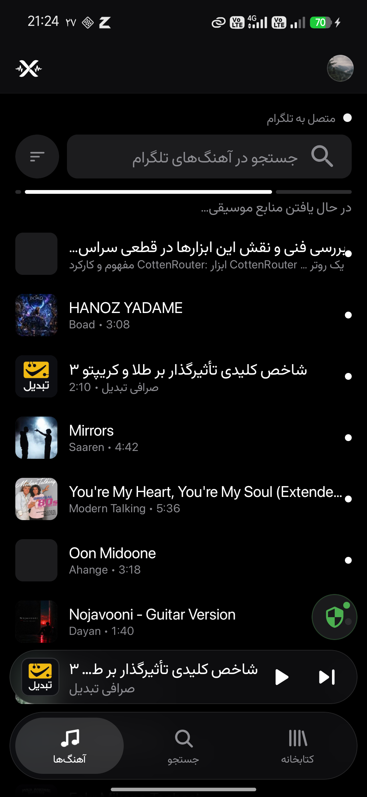
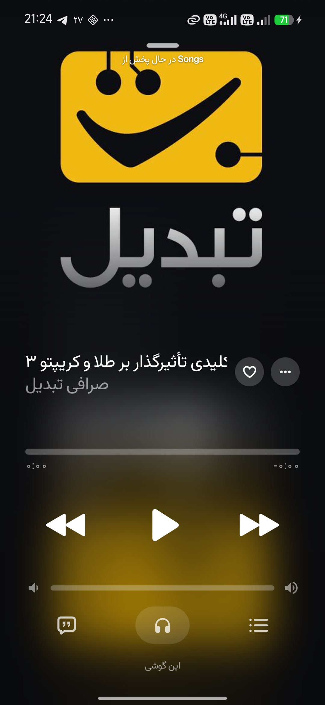
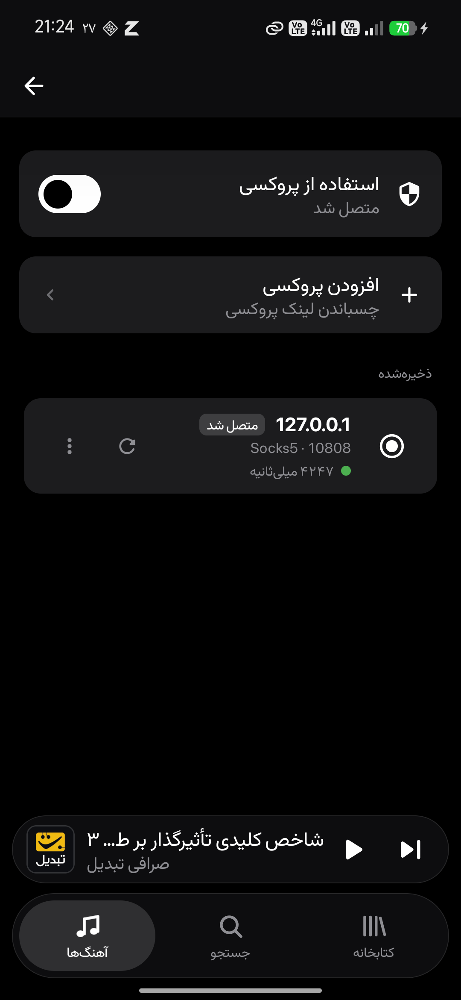

<div align="center">

<br/>


# Extrumz

**Your Telegram, as a music library.**

<br/>

[Features](#features) · [Before you build](#before-you-build) · [The proxy](#the-proxy) · [Build](#build) · [License](#license)

</div>

<br/>

<p align="center">
  
</p>

---

## What this is

A lot of music already lives in Telegram — in channels, in saved messages, in
groups with friends. It is there, it is yours, and there is no way to listen to
it as an album.

Extrumz is an Android music player that treats your Telegram account as the
library. It scans the chats and channels you point it at, reads the audio out of
them, and gives you the thing Telegram never had: a queue, playlists, liked
tracks, history, search, lyrics, and a now-playing screen worth looking at.

Nothing is uploaded anywhere. The tracks never move. It is the same files,
played properly.

<br/>

## Before you build

**Extrumz needs a Telegram `api_id` and `api_hash` of its own.**

Telegram requires every application to identify itself with credentials
registered to *that* application. Shipping someone else's — including the
well-known ones — gets an app rate-limited and eventually blocked, and the
people who feel that are the users, not the developer.

Getting your own takes about two minutes:

1. Go to [my.telegram.org](https://my.telegram.org) and sign in with your phone number.
2. Open **API development tools**.
3. Create an application. Any name and short name will do; platform **Android**.
4. Copy the `api_id` and `api_hash` it gives you into `local.properties`:

```properties
TG_API_ID=1234567
TG_API_HASH=0123456789abcdef0123456789abcdef
```

`local.properties` is already in `.gitignore`. Keep it that way — a hash that
reaches a public repository is a hash you have to revoke.

Without these, the app builds but cannot start a session: there is no credential
to start one with.

<br/>

## The proxy

Extrumz was built by someone who could not reach Telegram without one, so the
proxy is not a buried setting — it is a **screen**, and it sits on the welcome
screen beside the login buttons.

- **MTProto, SOCKS5 and HTTP** proxies.
- **A list, not a single field** — proxies are kept, named, and switchable.
- **Tested before trusted.** A proxy is checked against Telegram itself, on the
  datacenter your account actually uses, and the result is shown next to the
  direct connection — so "is this helping?" has an answer instead of a guess.
- **A shield on the home screen** while one is active, because a proxy that is
  on and forgotten is the state that gets people stuck.

On scope: MTProto is a Telegram protocol, so it carries Telegram traffic —
sessions, chat lists, audio, thumbnails. Cover art fetched from Deezer or
iTunes, and lyrics fetched over HTTP, take the normal route and are not
tunnelled. If those matter where you are, a system-wide VPN covers them too; the
two can run together.

<br/>

<div align="center">

<h2><a id="screens"></a>What it looks like</h2>

Real screens, in Persian, on a real phone.

<p align="center">
  
  
  
</p>

*Left: the library, indexed from Telegram. Middle: the player. Right: the
proxy screen — a list of proxies you keep, each tested against Telegram before
you trust it.*

<h2><a id="features"></a>Features</h2>

</div>

<table>
<tr>
<td width="50%" valign="top">

#### Library
- **Scan chats and channels** for audio, with progress you can watch and a
  bounded wait per page, so one slow chat cannot stall the rest.
- **Incremental, resumable scans** — one that stops picks up where it stopped.
- **Search** across everything indexed, with filters.
- **Sorting** by title, artist, album, duration or date added.
- **Local music** on the device, alongside the Telegram library.
- **Channels** view for the sources that keep publishing.

#### Playing
- **Background playback** over a proper media session.
- **Queue** with reorder, shuffle, repeat, and play-next.
- **Gapless** playback and crossfade.
- **Equalizer**, and an audio pipeline you can inspect.
- **Playback speed** and skip-silence.
- **Sleep timer**, including "stop after this track".

</td>
<td width="50%" valign="top">

#### Around the music
- **Playlists**, and adding to them from anywhere.
- **Liked** tracks and **history**.
- **Word-synced lyrics** from several providers, with a manual source picker for
  when the automatic choice is wrong.
- **Album art** from Telegram's own thumbnails first, then external databases.
- **Replay** — turn a track into a shareable image or story.
- **Animated now-playing** screen that takes its palette from the artwork.

#### The app itself
- **Persian and English**, with real RTL layout — not a mirrored afterthought.
- **Material 3**, dark by default, edge to edge.
- **Your session is encrypted at rest**; the app asks for nothing it does not need.

</td>
</tr>
</table>

<br/>

## Download

The latest signed APK is on the [Releases](https://github.com/P4rsw/Extrumz/releases)
page. Sideloading needs "Install unknown apps" enabled for whatever you download
it with.

## Build

Requires **JDK 21** and the Android SDK (compile SDK 37, minimum Android 8.0).

```bash
git clone https://github.com/P4rsw/Extrumz.git
cd Extrumz

# put your api_id / api_hash in local.properties first — see above

JAVA_HOME=/usr/lib/jvm/java-21-temurin ./gradlew :app:assembleProdDebug
```

The APK lands in `app/build/outputs/apk/prod/debug/`.

Tests:

```bash
JAVA_HOME=/usr/lib/jvm/java-21-temurin ./gradlew :app:testProdDebugUnitTest
```

For a signed release: `./tools/make-keystore.sh` creates a keystore once, and
`./release.sh` bumps the version, builds, and refuses to hand you an unsigned
APK while reporting success.

<br/>

## Contributing

See [CONTRIBUTING.md](CONTRIBUTING.md) and [CODE_OF_CONDUCT.md](CODE_OF_CONDUCT.md).
[ADDITIONAL.md](ADDITIONAL.md) has the longer notes.

<br/>

## Status

Working, and used daily, but still early. The library, playback, playlists and
the proxy screen are solid. If something is broken, a logcat is worth more than
a description.

<br/>

<div align="center">

<h2><a id="license"></a>License</h2>

</div>

**GPL-3.0.** See [LICENSE](LICENSE).

Extrumz is a fork of [**BitChord**](https://github.com/kushagrasinghx/BitChord)
by **Kushagra Singh** and its contributors, rebuilt around Telegram as the
source. The playback engine, much of the UI language and a great deal of the
code are theirs; the Telegram layer, the proxy handling, the library scanner and
the RTL work belong to this fork. Under the GPL that lineage stays visible, and
it should.

Lyrics animation is credited to [binimum/am-lyrics](https://github.com/binimum/am-lyrics).

<br/>

<div align="center">

<h2><a id="disclaimer"></a>Disclaimer</h2>

</div>

Extrumz is an independent, community-built player. It is not affiliated with,
endorsed by, or connected to Telegram, Google, YouTube Music, Deezer, or any of
their parent companies.

It plays what is already in your account. It does not host, provide, or
distribute music, and it does not bypass Telegram's terms of service — use your
own credentials, and only with material you have the right to listen to.

<br/>

---

<div dir="rtl" align="right">

## فارسی

**اکسترامز** — پخش‌کنندهٔ موسیقیِ اندروید که کتابخانهٔ موسیقی‌ات را از **تلگرام** می‌خواند: چت‌ها و کانال‌هایی که خودت انتخاب می‌کنی اسکن می‌شوند و آهنگ‌هایشان به یک اپ موسیقیِ واقعی تبدیل می‌شود — صفِ پخش، پلی‌لیست، لایک، تاریخچه، جست‌وجو، لیریکس و صفحهٔ پخش.

### قبل از ساخت، دو چیز لازم داری

**۱. `api_id` و `api_hash` خودت** — از [my.telegram.org](https://my.telegram.org). تلگرام اجازه نمی‌دهد اپی از اعتبارنامهٔ اپِ دیگری استفاده کند؛ اگر این کار را بکنی، اپ در مقیاسِ عمومی محدود و در نهایت بسته می‌شود. دو دقیقه وقت می‌برد و مسئله را برای همیشه حل می‌کند.

**۲. پروکسی** — اگر بدونِ فیلترشکن به تلگرام نمی‌رسی، صفحهٔ پروکسی همان اول و در کنارِ دکمه‌های ورود است. MTProto، SOCKS5 و HTTP پذیرفته می‌شود؛ پروکسی‌ها **ذخیره** می‌شوند و قبل از اعتماد **تست** می‌شوند — هم در برابرِ خودِ تلگرام، هم در مقایسه با اتصالِ مستقیم.

هیچ‌چیز جایی آپلود نمی‌شود. همان فایل‌هایی که در تلگرام داری، درست پخش می‌شوند.

**مجوز:** GPL-3.0 · این پروژه فورکی از [BitChord](https://github.com/kushagrasinghx/BitChord) اثرِ **Kushagra Singh** است.

</div>
